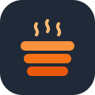

<div align="center">



# bobo-cooking-stack

**The only way to use agents.**

Three Claude Code skills for building real software with AI agents.

[](LICENSE) [](.claude-plugin/plugin.json)

</div>

<br>

<table>
<tr>
<td width="33%" align="center" valign="top">
<br>
<h3><a href="skills/glendonize/README.md">glendonize</a></h3>
<b>The only harness you need.</b> Drills for every function, a push pipeline that verifies, screenshot proof, and every decision remembered. You check proof, not code.<br><br>
<code>/glendonize</code>
</td>
<td width="33%" align="center" valign="top">
<br>
<h3><a href="skills/grilling/README.md">grilling</a></h3>
<b>Nothing gets built by guess.</b> Outcome first, Claude researches and proposes, then grills you on every decision and ends with what good looks like.<br><br>
<code>/grilling</code>
</td>
<td width="33%" align="center" valign="top">
<br>
<h3><a href="skills/whiteboard/README.md">whiteboard</a></h3>
Opens a hand-drawn board in your browser. You draw the structure, Claude reads it back.<br><br>
<code>/whiteboard</code>
</td>
</tr>
</table>

## Install

As a Claude Code plugin:

```
/plugin marketplace add bobocs50/bobo-cooking-stack
/plugin install bobo-cooking-stack@bobo-cooking-stack
```

Or as editable files, for any agent:

```bash
npx skills@latest add bobocs50/bobo-cooking-stack                   # all three
npx skills@latest add bobocs50/bobo-cooking-stack --skill grilling  # just one
```

Pick one way, not both. Each skill's own page has the details.

## Credits

[glendonC/1321](https://github.com/glendonC/1321), Kun Chen's [no-mistakes](https://github.com/kunchenguid/no-mistakes) and poteto's [pstack](https://github.com/cursor/plugins/tree/main/pstack) for glendonize, Matt Pocock's [skills](https://github.com/mattpocock/skills) for grilling, [nykooi1/vibe-wise](https://github.com/nykooi1/vibe-wise) for grilling's learning mode.

MIT licensed. Issues and pull requests welcome.
