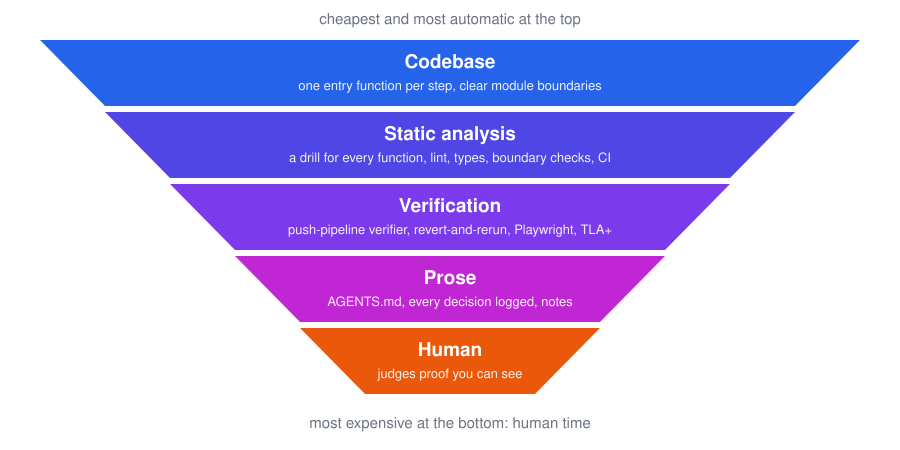

<div align="center">


# glendonize

**The only harness you need.**

Agents write the code. You check the proof: the test that pins a change, the reviewer's verdict, a screenshot, a number.

[](../../LICENSE) [](SKILL.md)

</div>

<br>

<p align="center"></p>

<p align="center"><sub>The trust pyramid by poteto (Lauren Tan). Every rule goes in the highest layer that can hold it. People only decide what no layer above can.</sub></p>

## What it builds, layer by layer

| Layer | What glendonize puts there |
|---|---|
| **Codebase** | One entry function per step file, clear boundaries between modules |
| **Static analysis** | A drill (a small free test) for every function, TDD for bugs, and new code cannot land without one. Lint, types, boundary checks that read the source, and a CI gate of free commands only |
| **Verification** | A push pipeline: a reviewer checks the change against what you asked for, a verifier confirms or refutes each finding, a fixer repairs small ones. Tests run again with the change reverted, to prove they would catch it. Playwright tests the UI on invented data. Where agents share state, a TLA+ model checks it |
| **Prose** | `AGENTS.md` rules for every agent, a numbered log where every decision is written down with its reason, open questions, vendor facts marked checked or not, and notes with one owner each |
| **Human** | You. You get before and after screenshots of every UI change, the numbers of a run, and the test that pins the fix. You rule on values, prompts and money |

## It remembers every decision

Each decision gets a number and a reason, and the code cites it. An agent that wants to change a rule finds why it exists first. A missing decision becomes an open question, and only that branch stops. After a long session, the state is rebuilt from disk, not from memory.

## Full or Yolo

glendonize asks first which one you want.

| | Full | Yolo |
|---|---|---|
| Rules, decision log, notes | yes | yes |
| Drills and lint before each commit | yes | yes |
| Push pipeline with verifier | yes | plain `git push` |
| Screenshot proof for UI changes | yes | yes |
| Guards against paid scripts and private folders | yes | no |
| Good for | long projects, real data | hackathons, prototypes |

A Yolo repo can be upgraded to Full later by running it again.

## Install

```sh
npx skills@latest add bobocs50/bobo-cooking-stack --skill glendonize
```

Then run `/glendonize` in a git repo. It works in gated phases and writes nothing on the first pass. Run it again later and it picks up where it stopped.

## Built from

- The structure from [glendonC](https://github.com/glendonC/1321)
- The push pipeline from Kun Chen's [no-mistakes](https://github.com/kunchenguid/no-mistakes)
- The trust pyramid from poteto (Lauren Tan), and the idea of one stack of skills that makes agents work like careful engineers from her [pstack](https://github.com/cursor/plugins/tree/main/pstack)

The full rules are in [SKILL.md](SKILL.md). [All skills](../../README.md)
