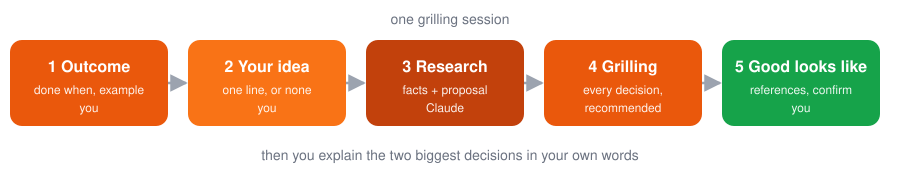

<div align="center">


# grilling

**Nothing gets built by guess.**

Outcome first. Claude researches and proposes, then grills you on every decision with its recommendation, and ends with what good looks like.

[](../../LICENSE) [](SKILL.md)

</div>

<br>

<p align="center"></p>

<p align="center"><sub>Facts are Claude's job, decisions are yours. Your idea comes before Claude's, so you decide instead of only approving.</sub></p>

## How it works

| Phase | What happens |
|---|---|
| 1. Outcome | You state the problem, what done looks like, and an example of good if you have one. Claude writes a `Done when:` line |
| 2. Your rough idea | One line in your words, or "none", before Claude shows anything, so its proposal can't anchor yours |
| 3. Research and propose | Subagents look up the facts. Claude shows its approach, the facts with their sources, and the open decisions |
| 4. Grilling | Every decision, in rounds of up to 4 clickable questions, each with Claude's recommendation. At a structure decision you sketch on the [whiteboard](../whiteboard/README.md) first |
| 5. What good looks like | A short note with your examples and the ones Claude found, checked against `Done when:`. Nothing is built until you confirm |
| Close | You explain the two biggest decisions in your own words |

With learning mode on, Claude teaches only the concept you are missing and asks you to apply it before it says more.

## Example

```
You:    grill me: our nightly export job sometimes sends the same report twice.
Claude: [1] Done when: each report goes out once per day, even after a retry.
Claude: [2] Your rough idea? -> you: "remember what was sent"
Claude: [3] Facts: the job retries on timeout (scheduler config). Approach: a sent-marker
            per report and day, checked before sending. Same as your idea, made exact.
Claude: [4] Key: Report id + date (Recommended) / Report id only
            Order: Mark before / Mark after sending (Recommended)
Claude: [5] Good looks like: the outbox pattern (link), one row per message sent.
```

## Files

| Topic | Description |
|---|---|
| [SKILL.md](SKILL.md) | The whole skill: the instructions Claude follows |
| [agents/openai.yaml](agents/openai.yaml) | Display name and short description for other agent tools |

## Install

```sh
npx skills@latest add bobocs50/bobo-cooking-stack --skill grilling
```

By hand, user-level on macOS / Linux:

```sh
mkdir -p ~/.claude/skills/grilling && curl -fsSL https://raw.githubusercontent.com/bobocs50/bobo-cooking-stack/main/skills/grilling/SKILL.md -o ~/.claude/skills/grilling/SKILL.md
```

Plugin install: see the [root README](../../README.md#install). For learning mode, copy
[templates/](templates/) to `~/.claude/learning/` (`cp -n templates/*.md ~/.claude/learning/`) and fill in `profile.md`.

## Built from

- The grilling with a recommendation on every question from Matt Pocock's [skills](https://github.com/mattpocock/skills)
- Learning mode from [nykooi1/vibe-wise](https://github.com/nykooi1/vibe-wise)

The full rules are in [SKILL.md](SKILL.md). [All skills](../../README.md)
