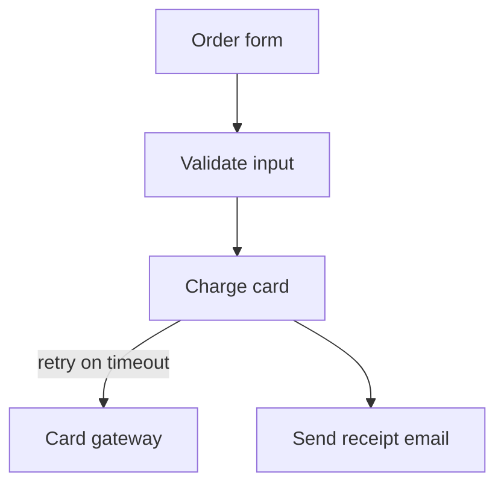

# whiteboard

[← all skills](../../README.md)

A Claude Code skill that opens a Mermaid flowchart as a full-screen, hand-drawn, editable
whiteboard in your browser. You move boxes, rename them, draw arrows and write answers next
to them; when you click **Send to Claude**, the board is saved as a PNG and as an Excalidraw
scene next to the `.mmd` file, and Claude reads both.

It exists because a structure decision (a new layer, step, data shape or boundary) is easier
to think through by drawing than by typing boxes and arrows into a chat. The board is local:
a small Python server on `127.0.0.1` and one HTML page. You install nothing beyond Python.

## What you see

One dark board that fills the window, Excalidraw's drawing toolbar, and a small bar at the top
right with two buttons:

| Button | What it does |
|---|---|
| **Save draft** (or Ctrl+S / Cmd+S) | Writes the PNG and the scene to disk and keeps the page open. A toast says "Draft saved" |
| **Send to Claude** | Writes the same two files, then the server exits. The button turns into "Sent ✓" and the toast says "Sent to Claude. You can close this tab." |

Excalidraw's own main menu, sidebar, welcome screen, theme toggle, background colour, "clear
canvas", "open file", "save to file" and export actions are hidden or turned off, so the two
buttons above are the only way out of the board.

## How it works

1. **You sketch first.** If you gave Claude boxes and arrows (in words or as Mermaid), it draws
   exactly that. If you gave only a topic, it asks for a rough sketch ("which boxes, which
   arrows, in your words") and waits. It draws its own alternative only beside yours, after it
   has questioned yours, or when you say "draw it for me".
2. **Claude writes the Mermaid** to `.lavish/<slug>.mmd` in the current working directory,
   following the rules in [Mermaid rules](#mermaid-rules) below.
3. **Claude starts the server** as a background command with a long timeout:

   ```sh
   python ~/.claude/skills/whiteboard/serve.py .lavish/<slug>.mmd
   ```

   `serve.py` picks a free port, prints `whiteboard at http://127.0.0.1:<port>/`, opens that
   address in your default browser and waits.
4. **The page builds the board.** `board.html` asks the server for a saved scene (`/scene`).
   If there is none, it fetches the Mermaid text (`/mermaid`), removes any `---` front matter,
   converts it to Excalidraw elements in the browser, and renders them hand-drawn and dark.
5. **You draw.** Move, rename, add boxes and arrows, write notes. **Save draft** as often as
   you like.
6. **You click Send to Claude.** The page exports the board as a PNG (dark background) and
   serializes the scene as Excalidraw JSON, and posts both to the server (`/done`). The server
   writes the two files, prints their paths and exits with code 0. Because the server ran as a
   tracked background command, its exit notifies the Claude session.
7. **Claude reads what you drew.** It reads `<slug>.png` (Claude Code's Read tool shows
   images) and, when the picture is not enough, `<slug>.excalidraw`, where each element's
   `text` field holds a box label or one of your notes.
8. **Claude updates the Mermaid** in `<slug>.mmd` to match your drawing. The Mermaid stays the
   record; the `.excalidraw` file is only the layout. At the end Claude pastes the final
   Mermaid into the conversation.

## Which files are written where

For `.lavish/checkout.mmd`, everything lands in the same folder:

| File | Written by | When | Contents |
|---|---|---|---|
| `.lavish/checkout.mmd` | Claude | Before the board opens, and again after you send it | The Mermaid flowchart, the record |
| `.lavish/checkout.excalidraw` | `serve.py` | On every Save draft and on Send to Claude (overwritten each time) | The full Excalidraw scene as JSON: elements, app state, embedded files |
| `.lavish/checkout.png` | `serve.py` | Same as above | The board as a PNG image |

The server writes nothing else and touches no other path. `.lavish/` is not ignored by git
automatically: add it to your `.gitignore` if you do not want the boards committed.

## Reopening a saved board

Run `serve.py` again on the same `.mmd`. The page loads `<slug>.excalidraw` first, so your
layout, your notes and your moved boxes come back exactly as you left them. While that file
exists, the Mermaid is **not** read, so changes Claude made to the `.mmd` do not show up.
Delete `<slug>.excalidraw` to start again from the Mermaid.

## Mermaid rules

The skill tells Claude to write the Mermaid this way:

- `flowchart TD` (top to bottom). No front matter is needed; the board is hand-drawn and dark
  by itself.
- One concept per board. A second concept gets a second board.
- Every box is named with the system-design term where one applies (cache, boundary,
  fallback, …). A box with no term is the first question Claude asks you.
- Arrows are bare (`-->`). A label only where it says something the boxes do not, like
  `-->|retry and reconcile|`. An uncertain edge gets `?` as its label.
- A question for you is a box of its own, linked with a dotted line:
  `Q1[/"Q: what happens when this fails?"/] -.- C`. You answer by writing on or next to it.

## Example

[`example.mmd`](example.mmd), shipped with the skill:



On the board this becomes five hand-drawn boxes, top to bottom: "Order form" → "Validate
input" → "Charge card", which splits into two arrows: one labelled "retry on timeout" to
"Card gateway", and one unlabelled to "Send receipt email".

To try it by hand from the skill folder:

```sh
python serve.py example.mmd
```

Draw something, click **Send to Claude**, and `example.excalidraw` and `example.png` appear
next to `example.mmd`.

### A session (made up, but true to the skill)

1. You type `/whiteboard checkout flow`.
2. Claude asks: "Which boxes, which arrows, in your words?" You answer: "form, validate,
   charge card, card gateway with retry, receipt email".
3. Claude writes `.lavish/checkout-flow.mmd` (like `example.mmd` above) and starts
   `serve.py`. Your browser opens on the board.
4. You add a box "Fraud check" between "Validate input" and "Charge card", and write "only
   above 500?" next to it. You click **Send to Claude**.
5. Claude reads `.lavish/checkout-flow.png`, sees the new box and your note, checks the exact
   wording in `.lavish/checkout-flow.excalidraw`, adds `fraud[Fraud check]` to the Mermaid
   in `checkout-flow.mmd`, and asks about the threshold you wrote.

## `serve.py` in detail

```
python serve.py <path/to/slug.mmd> [--port 0] [--no-open]
```

| Option | Default | Effect |
|---|---|---|
| `mmd` (required) | — | The Mermaid file. The scene and the PNG are written next to it |
| `--port N` | `0` | The port to listen on. `0` lets the operating system pick a free one |
| `--no-open` | off | Do not open a browser; open the printed address yourself |

- **Local only.** It binds to `127.0.0.1`, so nothing outside your machine can reach it.
- **Standard library only.** `http.server` (`ThreadingHTTPServer`), `json`, `base64`,
  `webbrowser`, `argparse`, `threading`, `pathlib`. Nothing to `pip install`.
- **Routes.** `GET /` serves `board.html`; `GET /mermaid` the `.mmd` text; `GET /scene` the
  saved `.excalidraw`, or 404 when there is none; `POST /save` and `POST /done` take
  `{"scene": ..., "png_base64": ...}` and write the two files. Responses carry
  `Cache-Control: no-store`, so a reload always gets the current files.
- **Logging.** Each request is printed to the console; on Send it prints `wrote <path>` for
  both files.

When it exits:

| Exit code | Cause |
|---|---|
| `0` | You clicked **Send to Claude** and both files were written |
| `1` | The server was interrupted (Ctrl+C) before Send to Claude. Claude then asks whether to reopen the board |
| `2` | The `.mmd` file was not found |

Closing the browser tab does **not** stop the server: it keeps waiting until Send to Claude
or an interrupt. Reopen the printed address to get back to the board.

## What is loaded from a CDN

The server serves only `board.html` and your files. The page itself loads from the internet:

| Library | Version | From |
|---|---|---|
| React, React DOM | 18.3.1 | `cdn.jsdelivr.net` |
| Excalidraw (and its fonts and assets) | 0.17.6 | `cdn.jsdelivr.net` |
| mermaid-to-excalidraw (the Mermaid → board conversion) | 1.1.2 | `esm.sh` |

Your drawing is never sent to these hosts; only the libraries come from them. Without access
to them the page shows "Load failed".

## Requirements

- Python 3.7 or newer (`ThreadingHTTPServer` arrived in 3.7).
- A current browser.
- Internet access to `cdn.jsdelivr.net` and `esm.sh`.
- Claude Code. `SKILL.md` starts the server from `~/.claude/skills/whiteboard/serve.py`, the
  user-level install path.

## Install

```sh
npx skills@latest add bobocs50/bobo-cooking-stack --skill whiteboard
```

Or as a Claude Code plugin, from inside a session (installs all skills in this repo):

```
/plugin marketplace add bobocs50/bobo-cooking-stack
/plugin install bobo-cooking-stack@bobo-cooking-stack
```

Or by hand, user-level on macOS / Linux:

```sh
mkdir -p ~/.claude/skills/whiteboard && for f in SKILL.md serve.py board.html example.mmd; do curl -fsSL https://raw.githubusercontent.com/bobocs50/bobo-cooking-stack/main/skills/whiteboard/$f -o ~/.claude/skills/whiteboard/$f; done
```

On Windows PowerShell:

```powershell
New-Item -ItemType Directory -Force "$HOME\.claude\skills\whiteboard" | Out-Null; foreach ($f in "SKILL.md","serve.py","board.html","example.mmd") { Invoke-WebRequest "https://raw.githubusercontent.com/bobocs50/bobo-cooking-stack/main/skills/whiteboard/$f" -OutFile "$HOME\.claude\skills\whiteboard\$f" }
```

## Run

In Claude Code:

```
/whiteboard                      # Claude asks what to draw
/whiteboard the upload pipeline  # what to draw
```

It also triggers on "whiteboard", "draw it" or "sketch this", and when a
[grilling](../grilling/README.md) reaches a structure decision. Installed as a plugin, the
command is namespaced: `/bobo-cooking-stack:whiteboard`.

## Files

| File | What it does |
|---|---|
| [`SKILL.md`](SKILL.md) | The instructions Claude follows: you draw first, the Mermaid rules, the loop above |
| [`serve.py`](serve.py) | The local server: serves the page and the `.mmd`, writes the scene and the PNG, exits on Send |
| [`board.html`](board.html) | The page: Excalidraw in dark mode, the Mermaid conversion, the Save draft and Send to Claude buttons |
| [`example.mmd`](example.mmd) | A five-box sample flowchart to try the board with |

## What it will not do

- **Draw before you do.** Your sketch comes first; Claude's alternative goes beside it.
- **Keep the drawing as the record.** The `.excalidraw` file is layout only; the Mermaid in
  the `.mmd` (and in the conversation) is what counts.
- **Work offline.** The libraries come from a CDN.
- **Read your Mermaid on reopen when a saved scene exists.** Delete the `.excalidraw` first.
- **Write other Mermaid diagram types.** The skill writes only `flowchart TD`, one concept per
  board.
- **Stop when you close the tab.** Only Send to Claude or Ctrl+C ends the server.

## Troubleshooting

| Symptom | Cause and fix |
|---|---|
| No browser window opened | Opening the browser can fail silently (no default browser, remote or headless machine). Copy the address from the first line the server prints, `whiteboard at http://127.0.0.1:<port>/`, into a browser. `--no-open` skips the attempt |
| `OSError` / address already in use | You passed `--port N` and that port is taken. Leave `--port` out (or pass `0`) to get a free port |
| `error: Mermaid file not found: ...` (exit 2) | The path to the `.mmd` is wrong. It is resolved from the current working directory |
| "Load failed: ..." on the page | The CDN is unreachable, or the Mermaid could not be converted. Check your connection to `cdn.jsdelivr.net` and `esm.sh`, then check the Mermaid syntax |
| The board ignores changes to the `.mmd` | A saved `<slug>.excalidraw` exists and is loaded instead. Delete it and reload |
| "Save failed: Error: 400" | The server could not write the files (for example the folder is read-only) or received a malformed request; the server console shows the reason |
| "Save failed: TypeError: ..." (a network error, such as "Failed to fetch") | The server is no longer running, usually because Send to Claude already ended it. Start `serve.py` again; your last save is loaded |
| The server exited with code 1 | It was interrupted before Send to Claude. Ask Claude to reopen the board; your last Save draft is kept |

## FAQ

**Does my drawing leave my machine?** Not through this skill. The page posts it only to the
local server on `127.0.0.1`, which writes it to disk. The CDN only serves the libraries.

**Why Mermaid and not just the Excalidraw file?** Mermaid is short text that reads in a diff
and pastes into a conversation or a doc. The `.excalidraw` JSON is long and full of
coordinates, so it is kept only so the layout survives a reopen.

**Can I use it without Claude?** Yes. `python serve.py some.mmd` works on its own; you get the
PNG and the scene next to the `.mmd`.

**Is the board light mode?** No. The page forces dark mode, also on reopen and in the PNG.

**What is `.lavish/`?** Just the folder name `SKILL.md` uses for board files. `serve.py`
accepts any path.

## Connected skills

- [grilling](../grilling/README.md) uses the board at structure decisions: you draw the first
  sketch, it questions the drawing, then draws its alternative beside yours.
- The system-design terms Claude names boxes with come from the "System design vocabulary"
  section of `~/.claude/learning/progress.md`, part of the
  [learning-by-building](../../learning-by-building/README.md), when you have it set up.
