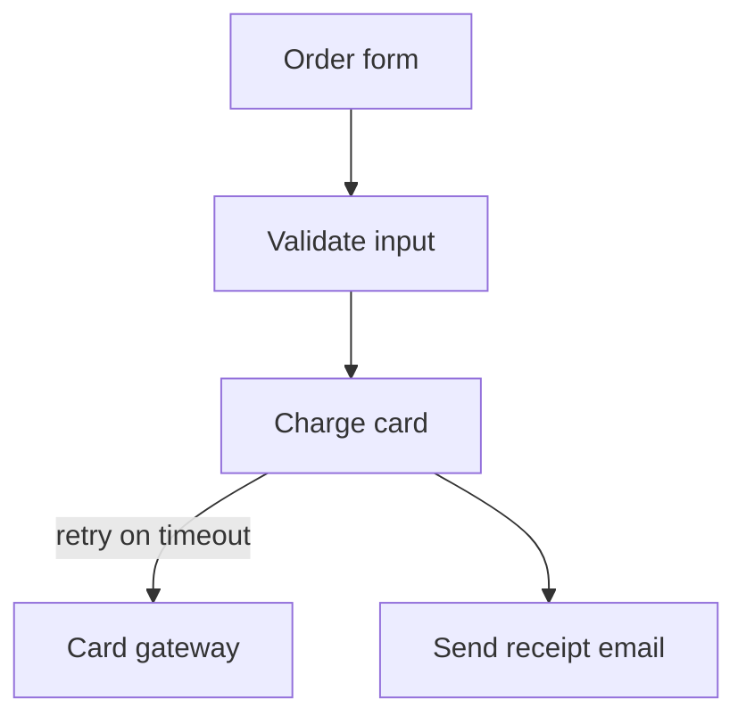

<div align="center">

# whiteboard

*Opens a Mermaid flowchart as a hand-drawn board in your browser; Claude reads what you draw.*

[](../../LICENSE)

[All skills](../../README.md)

</div>

A structure decision is easier to think through by drawing than by typing boxes and arrows into
a chat. You move boxes, rename them and write answers on the board. Run it with `/whiteboard`
or `/whiteboard the upload pipeline`.

---

## How it works

| Topic | Description |
|---|---|
| You sketch first | In words or Mermaid; Claude draws its own alternative only beside yours |
| Open | Claude writes `.lavish/<slug>.mmd` and starts `serve.py`, which opens the board |
| Save draft | Ctrl+S writes `<slug>.png` and `<slug>.excalidraw` next to the `.mmd` |
| Send to Claude | Writes the same files and stops the server, which tells Claude |
| Close board | Writes them and stops the server without sending, for when you are done for now |
| Read back | Claude reads the PNG and updates the `.mmd`, which stays the record |
| Local only | The server binds to `127.0.0.1`; the page loads its libraries from a CDN |

## Example



You add a "Fraud check" box, write "only above 500?" next to it, and click **Send to Claude**.
Claude adds `fraud[Fraud check]` to the Mermaid and asks about the threshold.

## Files

| Topic | Description |
|---|---|
| [SKILL.md](SKILL.md) | The instructions Claude follows |
| [serve.py](serve.py) | Local server: serves the page, writes the PNG and scene, exits on Send or Close |
| [board.html](board.html) | The page: Excalidraw, the Mermaid conversion, the three buttons |
| [example.mmd](example.mmd) | A five-box sample; try it with `python serve.py example.mmd` |

---

## Install

```sh
npx skills@latest add bobocs50/bobo-cooking-stack --skill whiteboard
```

By hand (macOS / Linux):

```sh
mkdir -p ~/.claude/skills/whiteboard && for f in SKILL.md serve.py board.html example.mmd; do curl -fsSL https://raw.githubusercontent.com/bobocs50/bobo-cooking-stack/main/skills/whiteboard/$f -o ~/.claude/skills/whiteboard/$f; done
```

Plugin install: see the [root README](../../README.md#install). Used by
[grilling](../grilling/README.md) at structure decisions.

## License

MIT. See [LICENSE](../../LICENSE).
