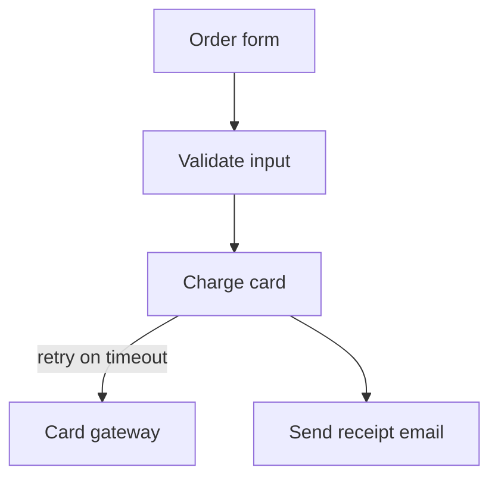

# whiteboard

[← all skills](../../README.md)

A Claude Code skill that opens a Mermaid flowchart as a full-screen, hand-drawn, editable
whiteboard in your browser. A structure decision is easier to think through by drawing than by
typing boxes and arrows into a chat. You move boxes, rename them and write answers on the board,
and Claude reads what you drew.

## How it works

1. You sketch first, in words or Mermaid. Claude draws its own alternative only beside yours.
2. Claude writes the Mermaid to `.lavish/<slug>.mmd` and starts `serve.py` on it.
3. Your browser opens on the board, built from the `.mmd`.
4. You draw. **Save draft** (Ctrl+S) writes `<slug>.png` and `<slug>.excalidraw` next to the `.mmd`.
5. **Send to Claude** writes the same two files and stops the server, which notifies Claude.
   **Close board** also writes them and stops the server, but sends nothing: use it when you are done for now.
6. Claude reads the PNG (and the scene for exact text) and updates the `.mmd`, which stays the record.
7. Local only: the server binds to `127.0.0.1`. The page loads its libraries from a CDN, so it needs internet.

## Example



You add a "Fraud check" box and write "only above 500?" next to it, then click **Send to
Claude**. Claude adds `fraud[Fraud check]` to the Mermaid and asks about the threshold.

## Install

```sh
npx skills@latest add bobocs50/bobo-cooking-stack --skill whiteboard
```

By hand (macOS / Linux):

```sh
mkdir -p ~/.claude/skills/whiteboard && for f in SKILL.md serve.py board.html example.mmd; do curl -fsSL https://raw.githubusercontent.com/bobocs50/bobo-cooking-stack/main/skills/whiteboard/$f -o ~/.claude/skills/whiteboard/$f; done
```

Plugin install: see the [root README](../../README.md). Run with `/whiteboard`
or `/whiteboard the upload pipeline`.

## Files

| File | What it does |
|---|---|
| [`SKILL.md`](SKILL.md) | The instructions Claude follows |
| [`serve.py`](serve.py) | Local server: serves the page, writes the PNG and scene, exits on Send or Close |
| [`board.html`](board.html) | The page: Excalidraw, the Mermaid conversion, the three buttons |
| [`example.mmd`](example.mmd) | A five-box sample; try it with `python serve.py example.mmd` |

Full rules in [SKILL.md](SKILL.md). Used by [grilling](../grilling/README.md) at structure decisions.
